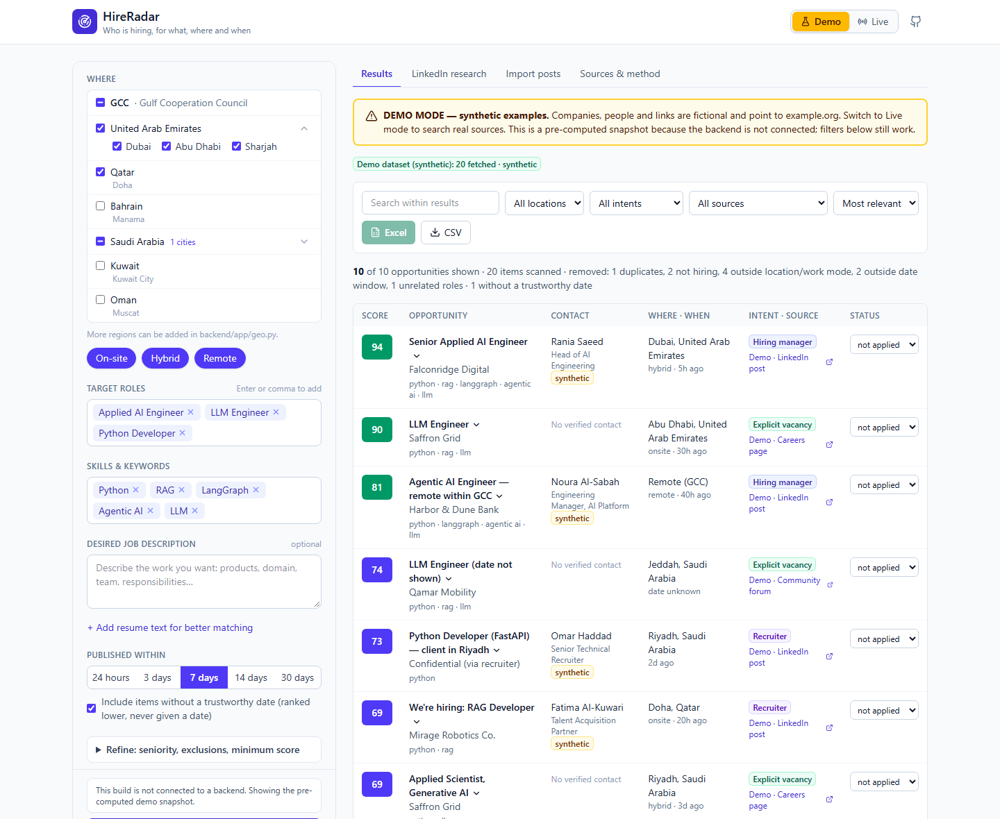

# HireRadar

**Find who is hiring, for what, where and when. Every match comes with the reasons behind its score.**

[](https://github.com/Pratik653/HireRadar/actions/workflows/ci.yml)
[](https://github.com/Pratik653/HireRadar/actions/workflows/pages.yml)


**[Open the live demo →](https://pratik653.github.io/HireRadar/)** No sign-up or install needed. Demo mode uses a
synthetic GCC dataset and labels it on every screen.

Job boards list vacancies. Many openings appear earlier, and sometimes only, as a post from a hiring manager,
recruiter or founder: *"My team in Dubai is hiring an LLM engineer, DM me."* HireRadar brings those
announcements together with structured vacancies from company career boards. It classifies how strong the
hiring signal is, scores each item against your roles, skills, locations and date window, removes duplicates,
and exports the result to a formatted Excel workbook with an application tracker.



## What it does

| | |
|---|---|
| **Targeting** | Region → Country → City selection (GCC: UAE, Qatar, Bahrain, Saudi Arabia, Kuwait, Oman), on-site/hybrid/remote, multiple job titles and skills, a free-text job description, optional resume text, exclusions, seniority, and a window of 24 h, 3, 7, 14 or 30 days |
| **Hiring intent** | Each item gets one of six classes: explicit vacancy, hiring-manager post, recruiter post, general recruitment, weak signal, unrelated. `#OpenToWork` and "I've joined…" posts are removed. Weak signals are labelled, never presented as vacancies |
| **Explainable score** | `100 × (0.4 role + 0.3 intent + 0.2 geography + 0.1 recency)`, with a breakdown and plain-language reasons for every result |
| **Matching** | Title normalisation (`Sr. ML Eng` → `senior machine learning engineer`), role families so "AI Engineer" doesn't match "AI Sales Executive", skill synonyms (RAG = retrieval-augmented generation), TF-IDF similarity |
| **Honest dates** | A date is shown only when the source provides one. Each is labelled *exact*, *reported* (Lever creation time or a date you entered) or *unknown*. Undated items are never given a date |
| **Deduplication** | Same URL, same company + title + city, or same company with near-identical text |
| **LinkedIn research mode** | Builds LinkedIn post searches and web searches for your roles, places and window. You open them in your own browser |
| **Import** | Paste a post, or upload CSV/JSON. Imports stay in your browser |
| **Export** | XLSX with *Hiring Leads*, *Search Summary* and *Application Tracker* sheets (frozen, filtered headers, validated links, formula-injection protection), plus CSV |

## Data sources

| Source | Status | What it gives you |
|---|---|---|
| Company career boards (Greenhouse, Lever, Ashby) | **Live** | Official public job-board APIs for the companies you add. Tested GCC boards: Careem, Tamara (Greenhouse), Ziina (Ashby) |
| [Remotive](https://remotive.com) | **Live** | Remote roles worldwide. Listings arrive 24 h late, per Remotive's terms, and link back to Remotive |
| Your imported posts | **Live** | Anything you collected yourself, from LinkedIn or elsewhere, scored with everything else |
| LinkedIn | **Research mode only** | See below |
| Demo dataset | Synthetic | Fictional companies and people, links to example.org, used only in Demo mode |

If a live source fails, the results say which one and why. HireRadar never fills the gap with demo data. Each
source's auth, coverage, rate limits and terms are documented in [docs/ARCHITECTURE.md](docs/ARCHITECTURE.md#sources).

### Why LinkedIn is not scraped

LinkedIn's User Agreement prohibits scraping and automated access, and logging in manually doesn't change that.
A hosted service that automated LinkedIn would also have to hold its users' session cookies. HireRadar
therefore never asks for, stores or forwards LinkedIn credentials, cookies or sessions. Research mode
generates the searches and you run them in your own browser. When you find a post worth tracking, copy it into
**Import posts**. The adapter interface leaves room for an official LinkedIn integration if partner access
ever becomes available.

## Architecture

```
frontend/  React 19 + TypeScript + Vite + Tailwind   → GitHub Pages (static)
backend/   FastAPI + Pydantic + scikit-learn + openpyxl → Render free web service (stateless)
tests/     backend tests (pytest); frontend tests live next to the code (vitest)
docs/      architecture, deployment, reference audit
```

The API has no database. Preferences, resume text, imports and application status stay in your browser's
local storage. The server processes each request in memory, reaches only an allowlist of four job-API hosts, and
never fetches a URL you supply. Details: [ARCHITECTURE.md](docs/ARCHITECTURE.md) · [SECURITY.md](SECURITY.md).

**Free-tier cold starts.** The API runs on Render's free plan, which sleeps after about 15 minutes idle. The
page starts waking it as soon as it loads and shows a short notice while it boots. Errors from the API
itself, such as validation or rate limits, are shown as errors rather than as a wake-up delay.

## Running locally

```bash
cd backend
python -m venv .venv && source .venv/bin/activate   # Windows: .venv\Scripts\activate
pip install -r requirements-dev.txt
uvicorn app.main:app --reload --port 8000
```

```bash
cd frontend
npm install
npm run dev        # http://localhost:5173, talks to http://localhost:8000
```

Tests: `pytest -q` in `backend/` (70 tests) and `npm test` in `frontend/`. Deployment:
[docs/DEPLOYMENT.md](docs/DEPLOYMENT.md).

## Limitations

- **Coverage depends on the boards you add.** HireRadar does not crawl job sites. Company boards and Remotive
  together cover far fewer GCC roles than the large job portals.
- **Weights are heuristics.** The 40/30/20/10 split and the intent scores were chosen to make the ranking
  readable. They have not been validated against labelled data.
- **Intent rules are English-only** and keyword-based. Unusual phrasing, or posts in Arabic, may be classified
  as weak or unrelated.
- **Location detection uses a catalog.** Places outside it (for example "San Francisco") are recognised only as
  "not in your selection".
- **No accounts, no sync.** Data stays in one browser. Clearing site data removes it.
- **Cold starts.** The first request after an idle period can take a while on the free tier.

## Roadmap

- More markets in the location catalog (Egypt, Jordan, India, Europe), with matching frontend entries.
- Additional authorised sources: Workable and SmartRecruiters public job widgets, and more Remotive-style APIs.
- A small labelled set of hiring posts to measure intent precision and recall and tune the weights.
- Optional lightweight embeddings, if they fit the free-tier memory budget.
- Arabic hiring-phrase rules.

## Acknowledgements

The idea of searching hiring *posts* rather than job listings, and of TF-IDF matching against a resume, comes
from [pritamdharme/linkedin-hiring-post](https://github.com/pritamdharme/linkedin-hiring-post). That
repository has no licence, so none of its code is used here. HireRadar is an independent implementation.
See [docs/REFERENCE_AUDIT.md](docs/REFERENCE_AUDIT.md) for the review.

## License

[Apache-2.0](LICENSE). See [NOTICE](NOTICE).
